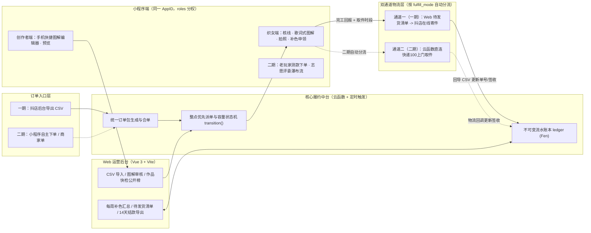

# 无限天真（织女平台）业务与系统总架构蓝图

版本：2026-11-21　　状态：全局架构定稿（一期 MVP 开发前置蓝图）

本蓝图整合了原有业务需求、抖店与物流调研结论、《无限天真_直播间》商业定位更新，以及与 `luckyducky-fable` 工程底座对齐后的最终技术决策。开发阶段严格遵循**“全局留接缝、一期做最薄”**原则：所有二三期能力只在一期保留数据字段与边界，绝不提前编写二期功能代码。

## 1. 品牌定位、品类与商业模式

### 1.1 品牌与品类聚焦

- **品牌定位**：「无限天真」（想让世界好一点点），本质是**去中心化的云端手工艺工厂**。对外公开声明不从织女手作中赚取利润，保障手工艺人应得报酬与松弛的创作状态。
- **品类聚焦**：主攻**无实际功能的摆件与挂件**，对标泡泡玛特做 **IP 化、形象化、系列化**（例如「天真宝宝」sasa / papa / haha 及梦想厨房、奇幻森林、旅行家、小花园等主题系列），避开服装/实用类产品的尺码与高退换难题（包包等实用类暂留待定）。
- **不碰织女现货**：正式废止原“现货一次性清仓计划”，织女手上零散现货仅用于入驻时证明手工能力，平台从一开始直接下生产订单。

### 1.2 平台盈利来源（解开“不赚织女钱”的收支闭环）

1. **直播间日常消耗品带货（主收入）**：高频回购的消耗品作为直播间核心收入来源。
2. **精品教程与配套内容盈利**：涵盖图解创作、成品拍摄、软件配套及博主上传的教学视频。
3. **付费图解制作服务**：不会写图解的创作者可付费制作图解，完成后图解可对外收费。
4. **第三方 B 端与达人服务费**：平台不赚手工艺人的钱，但向入驻使用云端织女产能的第三方博主、达人、商家、中间商收费（含帮爆火视频博主承接代钩订单并分账）。

### 1.3 双层渠道与选款分流

- **抖音直播间（稳定爆款 + 消耗品）**：只主推**个位数已验证的稳定款，甚至持续单款打爆**，搭配日常消耗品带货。降低路人决策成本、大幅压缩织女备料与学习成本、减少同行抄款价值。
- **微信小程序（老玩家测新款，二期开放自主下单）**：承接高意向老玩家，专门售卖更新、更多样的小众款/测试款；经老玩家买单验证稳定后，再推上直播间主推。

## 2. 全局系统架构与技术底座

### 2.1 独立建仓与复刻策略

- **物理隔离，绝不勉强合并**：不合并进生产中的 `luckyducky-fable`（小棉鸭材料包电商）仓库、小程序和云环境，避免试错期改动波及线上真实交易与微信提审节奏。
- **复刻成熟工程底座**：独立新建代码仓库、独立小程序 AppID、独立微信云开发环境，直接复刻 `luckyducky-fable` 已经验证过的 `rewrite/{mp, cloud, admin, shared}` 骨架与工程不变量：
  - **微信小程序（`rewrite/mp`）**：原生 TypeScript 小程序，`pages -> lib` 分层；一账号多角色（`roles` 数组），一期承载**织女作业端 + 创作者图解录入**，二期扩展买家测款与志愿评委入口。
  - **Web 运营后台（`rewrite/admin`）**：Vue 3 + Vite + `tokens.css` 视觉体系；负责抖店 CSV 增量导单、款式/图解审核上架、作品快速检阅与公开榜、每周补色发料汇总、待发货清单、14 天结款与流水对账。
  - **微信云开发后端（`rewrite/cloud` + `rewrite/shared`）**：TS + esbuild 打包、`adminApi` / `app` 双入口、`kit` 写库闸门、`transition()` 唯一订单状态机、`Fen` 整数分金额类型、定时触发器、私有云存储短时效链接，以及第三方短信派单提醒。

### 2.2 系统分层与数据流向

## 3. 核心业务域与定稿规则

### 3.1 订单管理与双通道物流

- **统一订单包模型（`order_packages`）**：无论外部渠道如何，统一在入口转为内部订单包（自建内部主键 ID + `channel` + `external_order_id` + 质量档位 `tier` + 下单价格/款式快照）。晚间直播、次日 9:00 起派单，派单前的合单窗口内（不要求严格 12 小时）同顾客多笔订单合并为一个订单包，整包交由一位织女制作，交期从付款起 14 天；每天派单前约 8:30 重新导出订单与售后 CSV 并先处理退款。
- **双通道物流自动分流（对织女完全屏蔽差异）**：
  - 无论订单来自抖店还是小程序，织女端最后一步完全统一：**装袋贴封签拍照 → 选择方便上门的取件时段 → 点击提交发货**。
  - **通道一 `douyin_online`（一期主通道，承接抖店订单）**：系统不存买家明文地址（仅存省市用于同省优先派单）；织女提交后进入 Web 后台「待发货清单」（支持一键复制抖店订单号 + 显示织女工号对应的抖店地址库简称与取件时段），运营在抖店后台点击“在线寄件并发货”，并定期回导抖店订单/售后 CSV 同步退款、单号与签收时间。
  - **通道二 `kuaidi100_pickup`（二期接入，承接小程序测款单、商家单、退货再售单）**：买家完整地址存入仅云函数可读的独立 `addresses` 集合；织女提交后由云函数自动调用快递100线上支付版预约上门取件，并通过回调自动写回单号与签收时间。
  - **运费账务分两类**：买家订单——抖店在线寄件从抖店钱包扣款、快递100线上支付版从预充余额扣款，平台统一结算、织女无需现付，共用同一套邮费分担公式；织女样品寄回（二期）——走快递100线下支付，织女现付快递员，验收后平台按固定额度补贴。

### 3.2 织女筛选、分级与线性履约

- **四轮筛选漏斗**：海选（线上答题）→ 初选（查看历史作品）→ 复试（按指定款式制作）→ 终选（制作真实产品款，合格即长期合作）。
- **四类人员分流管理**：①需淘汰、②常规代钩织女（1、2 类尽量自动化处理）；③常规创作织女（需人工判断）；④有流量的博主创作者（开通特殊合作通道）。
- **作品快速检阅与公开标准榜**：Web 后台支持对织女提交的作品快速点击「入选 / 不采纳」、填写具体理由并打 Tag，同时对外公开入选与不采纳名单，帮助全体织女对齐品质标准。
- **线性履约与封装降本**：
  - 每天 9:00–13:00 整点优先派单（不设抢单池），每次最多 3 单、1 小时内扫线团条码确认接单，按可用工时 70% 上限与第 12 天前可完工校验过滤。
  - 队首订单包解锁图解；完工后扫描**通用半透明八边封袋 + 平台定做的唯一二维码贴纸**绑定订单包 → 现场拍成品照送审（一期运营审，二期转 2 位志愿评委瀑布流投票）→ 审过装袋贴一次性封签再拍 → 选可取件时段提交发货，队首推进至下一包。
  - 织女与买家全程信息隔离，问题统一由平台客服处理。

### 3.3 材料体系与线材预算池（终版统一规则）

- **废弃旧三档与橱窗外采**：正式废弃原 7/12/24 色三档机制，取消“挂橱窗链接让织女自采”。
- **统一补料机制**：织女入驻只需自备 **12 色基础包**；平台所有指定补充色号与特殊材料，一律通过小程序**每周按需申领**，由运营每周固定一天汇总打包发出。平台直接掌握完整发料记录，既降低织女囤货心理负担，又防止材料供应链外流。
- **个人专属线材预算池（严禁透支）**：
  - 每位织女拥有独立的个人线材预算池，**不允许透支**（新人先接基础 12 色订单攒够额度，再申领补充色号，平台零垫资、零坏账）。
  - 每单结款时，从织女应得中按约定划出一部分进入个人线材预算池（`yarn_pool_accrual`）。
  - 每周申领补充色号/指定材料时，服务端校验 `个人池余额 >= 材料成本 + 实际低价邮费` 后扣减（`yarn_claim_deduct`）；织女签收补色包后，系统自动点亮她手上的扩展色号（`extra_colors`），随即开放对应新款派单。
  - **退出清算条款**：织女协议中明确，织女彻底退出不再接单时，个人线材预算池内未用完的余额随最后一次 14 天结款退还。

### 3.4 创作者生态与小程序结构化图解

- **创作者五级分层与双轨分配**：按创作与流量能力分五级（流量创作博主 > 钩织创作博主 > 原创形象+图解 > 按已有形象做图解 > 按图解制作）。**图解按独创性双轨分配**：创新性低、无独创性的款式按「贡献者」分配，不注册版权；真正具独创性与商业价值的款式申请版权，并按「创作者」获得**按件固定金额分成**（`royalty_fen`）。
- **小程序端创作者图解编辑器（一期先内部录入试跑，二期开放外部创作者）**：
  - 挂在同一个微信小程序的 `creator` 角色下，适配手机端边钩边记习惯。
  - 提供**钩织专属快捷符号栏**（`X / V / A / T / F / CH / SL / BLO / (...)× / 下一圈` 自动递增圈号）、**粘贴纯文本一键拆行**、**平台色卡直选**（置顶 12 基础色，折叠扩展补色）、**手机相机直拍步骤细节图**、**草稿自动保存**以及**一键预览织女歌词视角**。
  - Web 后台负责图解审核、核定标准工时/用线量/分成金额与上架。
- **织女端歌词式图解界面**：
  - 底层存成**按部位 → 圈/行拆分的结构化步骤 JSON**（后期天然支持模块化图解定制与安卓独立悬浮窗 APK）。
  - 界面采用当前行放大高亮 + 上下行半透明预览、底部防误触大按钮步进与针数进度自动保存、一键切换**“分屏精简模式”+ 屏幕常亮**（引导织女配合安卓系统分屏或 iOS 短视频画中画“反浮”实现边看短视频边钩织）。
  - 全屏平铺织女工号水印、私有云存储短时效链接、订单结束失效，并开启微信截屏/录屏保护能力。

### 3.5 不可变资金账本与多角色分账

- 全链金额使用 `Fen`（整数分），所有资金变动只向不可变流水表 `ledger` 追加记录（纠错用冲正，对外不做钱包），余额永远由流水汇总得出。
- 买家签收满 7 天未退货转入待结款，每 14 天批量结款一次（一期运营导出清单手工银行转账，二期升级批量结款工具）。
- 不设定金。织女接单即算开工：固定款开工后被取消的，织女继续做完并登记为余货，同款订单优先派给她，按新订单结工价；非固定款（二期）仅限自愿接受风险的织女，配成团制、风险溢价、有限补偿与余货处置等兜底。
- 流水表通过 `payee_id` + `entry_type` 统一承接多角色分账：`craft_fee`（织女工价）、`trial_compensation`（二期非固定款有限补偿）、`shipping_reimburse`（邮费分担）、`yarn_pool_accrual`（划入线材预算池）、`yarn_claim_deduct`（每周领料与邮费扣减）、`design_royalty`（创作者按件分成），后期直接追加博主分佣、退货再售补款、保证金扣减或备选补助池。

## 4. 后期演进接缝清单（一期只留边界，不写二期代码）

| 后期扩展能力 | 一期必须留好的数据/架构接缝 |
|---|---|
| 抖店 API / 小程序自主下单 / 商家批量单 | `order_packages` 使用自建内部 ID 作主键，外单放 `channel` + `external_order_id`，并预留 `tier` 档位字段。 |
| 快递100上门取件 / 顺丰直连 | `shipments` 独立建表，带 `fulfill_mode`（一期固定 `douyin_online`）；独立建仅云函数可读的 `addresses` 集合（一期空置）。 |
| 评委瀑布流 / 精品与标准分档 / 创作者兼织女 | 用户权限用数组 `roles` + 能力标签 `tags`（不用互斥单角色）；照片审核独立建 `photo_reviews` 表。 |
| 创作者分成 / 博主分佣 / 退货再售 / 补助池 | 严格走 `ledger` 不可变流水 + `payee_id` + `entry_type` 枚举，不写死固定扣费列。 |
| 安卓织女桌面歌词悬浮窗 APK / 模块化定制 | 全部业务逻辑与状态流转收口至云端 `transition()`；图解必须以按部位/圈行拆分的结构化 JSON 存储。 |
| 与 `luckyducky-fable` 进销存/外协联动 | 线材色号和款式保留独立 `yarn_code` / `sku_code` 编码字段，跨系统按编码对账或轻量接口互通。 |

## 5. 三期演进路线图与一期 MVP 冻结边界

| 阶段 | 核心目标 | 端与渠道 | 履约、材料与图解 | 治理与生态 |
|---|---|---|---|---|
| **一期 MVP** | 3–5 位种子织女跑通单款/少款闭环 | 独立新仓（复刻小棉鸭底座）+ Web 后台 + 织女/内部创作者小程序 | 抖店 CSV 增量导单 + 抖店在线寄件；12 色基础包 + 个人不可透支补色池；小程序内部录图解 + 织女歌词式图解；八边封袋 + 贴纸 | 种子织女邀请制；运营人工审照；14 天导出流水手工结款；作品快检与公开标准榜（最小版） |
| **二期增长** | 扩大织女规模、开通老玩家测新款 | 小程序开放**买家自主下单测新款**、外部创作者录入、志愿评委入口 | 接入**快递100上门取件**双通道分流；上线每周补色自动化汇总 | 四轮筛选漏斗全面运行；2 位志愿评委瀑布流审照；退货验封签入库与再售；外部创作者按件分成自动记账 |
| **三期生态** | 放大云端手工艺工厂生态 | 增开商家 Web 门户；视安卓织女占比按需打包**安卓悬浮窗 APK** | 视单量评估抖店 API / 顺丰月结；上线模块化图解灵活定制 | 精品/标准质量分档；吸纳小团队管理者与商家批量单；博主教学视频、代钩流量分佣与公益拍卖 |

**一期明确不做（冻结范围）**：不做买家小程序商城与微信支付、不接抖店开放平台 API 和快递 API、不开放外部创作者注册、不做安卓独立悬浮窗 App、不做自动银行打款与退货再售池。

## 6. 一期开工前的 4 道最后闸门

1. **法律与税务定性确认**：向律师和会计确认①“平台自营委托加工 vs 撮合”合同模型；②抖店标准商品无理由退货与定制商品的规则边界（不设定金）；③平台通过个人线材预算池每周发补充色号的税务入账口径；④前期选用市面已有款式时的版权合规底线。
2. **抖店后台两项最小实测**：导出一份真实抖店订单 CSV 核对去重、同顾客合单与退款状态字段；用第一批真实顾客订单（不自购、不刷单）验证 1 笔异地织女的真实“在线寄件”取件。
3. **敲定首批业务参数**：确定 3–5 位种子织女名单、首批 1–3 个主推款的标准工时、12 色基础色号及条码表、每单固定费用（运营费、包装费、邮费分担）及个人线材预算池的每单划入比例。
4. **初始化独立工程环境**：注册独立小程序 AppID、开通独立微信云开发环境、新建 Git 仓库并从 `luckyducky-fable` 抽骨架初始化项目，提前在抖店地址库按“织女工号 + 姓名”录好种子织女寄件地址。
