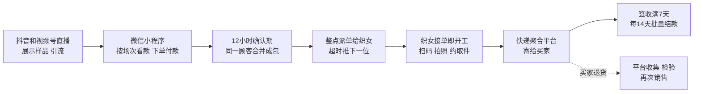

# 织女平台 业务需求文档

版本：2026-11-14　　项目：准公益钩织手作预售平台（微信小程序）　　负责人：Flever

> 本文件由以下来源合并整理而成：需求文档（截至第四轮决策）、交接文档（含第五轮待答卡片）、全局审核、行业角色方案，以及抖店、快递100的核实结果。**第三部分的内容全部是提案，用户尚未确认。**

## 0. 阅读说明

**状态标记**：`已定` 用户已明确决定；`建议` 我提出、用户未反对但未明确确认；`待核实` 取决于外部答复（律师、会计、平台规则）或数据。

**文档结构**

- 第一部分：业务模式与原则
- 第二部分：需求条目（按模块，共 12 个模块，来自需求文档）
- 第三部分：需求文档之后的更新：第五轮待答决策、待确认项、空缺与冲突
- 第四部分：后续设计提案（渠道分档、织女海选与评级、商家订单、行业角色）
- 第五部分：风险与合规：全局审核、律师与会计问题
- 第六部分：抖店与快递100对接调研
- 第七部分：下一步

# 第一部分 业务模式与原则

- **定位**：准公益的钩织手作平台。通过一个微信小程序汇集全国各地的织女，对外公开声明不从织女手作中赚取利润，尽量把销售所得给织女。
- **交易场所**：统一一个微信小程序。抖音和视频号直播只做内容与引流，所有交易在微信小程序里。抖音小程序、抖店暂不做。
- **业务模式**：买家在小程序下单，系统分配给个人织女；织女自备材料、自己制作、在期限内寄给买家。平台不囤货，但会收集买家退货并尝试再次销售。主要是预售接单，少量寄售。
- **隔离**：织女与买家没有沟通渠道，互相看不到个人信息，问题统一联系平台客服。
- **交期**：从买家付款起 14 天。
- **立场**：平台中立，但偏向保护织女。用户明确说过，规则上织女是弱者，可以容忍对织女有利的小漏洞。
- **用词**：对外不用“钱包”“抽成”“利润”等词。
- **主体与技术**：个体户；uni-app 加微信云开发（云函数、云数据库、云存储、定时触发）。

# 第二部分 需求条目

说明：本部分来自需求文档，已同步到第四轮决策。第五轮结论尚未写入，见第三部分。

## 1. 项目概述

### OV-1　定位　`已定`

通过微信小程序汇集全国各地的织女，不赚取利润，把织女手作的销售所得最大化给予织女。对外公开声明：不从织女手作中赚取利润（事实也如此）。

### OV-2　业务模式　`已定`

买家在小程序下单，系统自动分配给个人织女；织女自备材料、自己制作、在期限内自己寄给买家。平台不囤货，但会收集买家退货并尝试再次销售，再给织女结款。主要是预售接单，少量寄售。

### OV-3　织女与买家　`已定`

织女与买家没有沟通渠道。问题统一联系平台客服。

### OV-4　主体　`待核实`

个体户。具体经营类目、微信支付商户号能否开通，尚未核实（见第 14 章）。

## 2. 渠道与入口

### CH-1　统一一个微信小程序，入口决定身份　`已定`

买家下单、织女接单与制作发货共用一个微信小程序，但首次进入就按入口分流：买家从直播间、场次海报、分享卡片进入，直接看到买家首页；织女从邀请二维码或邀请链接进入，先验证邀请码。从搜索进入、无法判断身份时，显示入口选择页（我是买家、我是织女）。身份绑定微信号，一个微信号只绑一个身份。买家想成为织女，由运营在后台转换一次，转换前要先结束未完成的订单。评委是买家身份上的附加权限，在买家端多一个“评审”入口。抖音小程序、抖店、抖音挂载都不做。

### CH-7　直播只卖专业订单　`已定`

直播间只卖专业订单，即用平台指定线材、色号可扫码核验的订单。一位顾客只会处于一个订单等级，不做混合购买。订单等级叫“专业订单 / 普通订单”，与织女评审的分数无关。普通订单（织女自备线材）第一期不做，只在需求里挂一条后续，随织女逐步转用指定线材再视情况开放。

### CH-2　直播引流　`待核实`

抖音和视频号直播只做内容与引流，所有交易发生在微信小程序里。引导方式分级：先用平台官方允许的承接（主页、粉丝群等），直播间直接口播微信号或小程序名暂不使用，等向平台确认规则。

### CH-3　随直播上新才展示　`已定`

款式有 未上架、已上架、已下架 三个状态。只有在直播中点“上架”的款，才出现在小程序里；没有上链接的款完全不展示。

### CH-4　按场次展示　`建议`

小程序首页以直播场次为单位：当前直播场次置顶并标“直播中”，其后按时间倒序。已上架的款在直播结束后继续保留、可下单，直到手动下架。

### CH-5　款号直达　`建议`

直播画面标短款号（如 A12），小程序顶部提供款号输入框，输入后直达该款。

### CH-6　订单记录场次　`建议`

每个订单记录所属直播场次，后台可按场次看成交、取消、退货。

## 3. 买家端

### BY-1　下单与支付　`已定`

买家在小程序选款、选色、下单，用微信支付付款。

### BY-2　邮费　`已定`

邮费按寄件数量算：一个包裹一份买家分担的邮费。对外表述为买家与织女平摊。原方案为每包 3 元，是否仍是 3 元待确认。

### BY-3　12 小时确认期　`已定`

付款后有 12 小时确认期，期满后订单才进入待分配。期内买家可取消，同一顾客的多个订单合并成一个订单包。

### BY-4　单个顾客总量上限　`已定`

同一顾客同一时期所有未寄出产品的总工时，不超过一位标准织女 14 天可用工时的 70%（至少保留 30% 的时间）。购物车超限时提示分次下单。具体上限需要每个款的标准工时和标准织女每天可用小时数。

### BY-5　选色提示　`建议`

买家选到只有高档位织女才有的色号时，下单页提示“制作人选较少，预计更久”。

### BY-6　色号上架门槛　`已定`

种子阶段取消这条门槛。全面开放后恢复：每个款或颜色选项上架时，系统检查能接这个色号的织女数量，低于阈值（暂定 10 位）不开放。

### BY-7　交期与进度　`建议`

买家能查看订单状态（待确认、制作中、已发货、已签收）和快递轨迹。交期从付款起 14 天，其中分配最长占约 1 天。

### BY-8　取消与退货　`已定`

取消：确认期（付款后 12 小时）内全额退款；确认期结束、织女接单之前取消，退全款；织女一旦接单就算开工，不需要再点“开始制作”，也不需要证明，此后取消定金（商品价的 20%）不退，全额归织女，其余退回。织女约取件之后不能取消，只能签收后按退货处理，拒收等同未拆封退货。退货：7 天检视期内、商品未拆封的，可退货退款，定金不退，退货运费买家出；已拆封不支持无理由退货。拆封后才发现的质量问题，凭照片联系人工客服，由运营判断。手工商品没有质保期。平台立场中立，但偏向保护织女。具体表述需律师确认。

### BY-9　定金显著标注　`已定`

下单页显著标注商品价的 20% 为定金，例如预售价 100 元、其中 20 元是定金，织女接单后取消仅退 80 元。买家必须勾选“已阅读，同意定金规则”才能付款。商品详情页和订单页同样标注。

### BY-10　透明包装与封签　`已定`

成品用透明包装，买家不拆封就能检视。包装带一次性封签，织女装袋拍照时就留底。买家退货寄回后，平台收货时验封签：封签完好按未拆封处理，退货退款；封签损坏按已拆封处理，不退。

### BY-11　每场可售数量　`已定`

每场直播、每个款的可售数量由运营手动填写，卖完即止。后台显示织女总剩余工时，供填写时参考。

### BY-12　超期处理　`已定`

交期从付款起 14 天。第 12 天提醒织女。超期后买家可选继续等，或全额退款（含定金），织女记一次超期，超期记录影响排序。

### BY-13　取消限次　`已定`

每位买家每周只能取消一次订单（确认期内取消和织女接单前取消都算）。取消后库存立即放回。用来防止反复下单再取消、占光每场的可售数量。

## 4. 订单与分配

### OR-1　订单单位是顾客的订单包　`已定`

同一顾客的订单在分配之前（含确认期）合并成一个订单包，整包只给一位织女，整包做完才寄，一个包裹、一个码。织女开始制作后，该顾客再下的订单成为新的包。

### OR-2　优先分配制，不抢单　`已定`

订单进入待分配后，按整点派单推给织女；织女在 1 小时内确认接受，超时则推给下一位。不设开放抢单池。

### OR-3　整点派单　`已定`

每天 9:00 到 13:00 每个整点派一次单，最晚 14:00 结束。每位织女每次最多收到 3 单，1 小时内回复，可以一单都不接（不扣分，记回复率）。待确认的订单都先占用她的容量。当天没分出去的，次日 9:00 再派。每天都派（含周末与节假日），织女可在接单开关里设休息日。同一个订单最多依次推给 5 位织女。

### OR-4　候选筛选　`已定`

先筛掉不合格者：接单开关关闭或休息日、容量满、色号不全、预计邮费超上限。再按层级排：有现成品、原织女回头客、同省、同大区、全国。同层里：订单少时按机会均等，近 14 天接单少的优先；订单多时再叠加信用分。

### OR-5　拒绝、超时与拖单　`已定`

主动拒绝和超时都不扣信用分，但记回复率和接单率，接单率低的织女在排序里靠后；连续 3 次超时暂停派单 7 天；关闭接单开关不受影响。系统统计每位织女“接单后被买家取消”和超期的比例，超过阈值暂停派单，阈值等有数据后再定。

### OR-6　没人接怎么办　`建议`

5 位用完先放宽层级，次日 9:00 的批次再取 5 位；仍无人或累计超过 24 小时，进待处理，由运营联系买家，按买家意愿等、换款或退款。

### OR-7　织女的订单队列　`已定`

织女可以接多个订单包，按接受顺序固定排队，不能调整。只有队首能看图解；后面的只看款式、材料清单和预计开始日期。队首约取件成功后，下一包才成为队首。

### OR-8　容量按工时算　`已定`

织女手上所有未寄出订单包的工时之和，不超过她 14 天可用工时的 70%（保留 30%）。每位织女自报每天可用小时，系统用真实记录修正。

### OR-9　队列内取消　`建议`

织女接单后买家取消，不论是否轮到制作，定金都不退并归织女，订单包出队，后面顺延；包里取消一件而其余还在，包继续。

### OR-10　队首卡住　`建议`

队首因快递没来、码损坏、材料断货卡住时，织女点“卡住了”选原因，由运营放行或改派，织女不能自己跳单。快递没来就重新约取件，不提供“自己去寄”，织女始终看不到买家地址。

## 5. 织女端

### WV-1　线性工作流　`已定`

织女的整个工作流是单方向线性的：前一步完成，下一步才开启；每一步只需要确保一个点完成。服务端检查前置步骤，前端按钮灰着不算数。

### WV-2　每一包的流程　`已定`

接受并核对材料（接单即算开工，是定金的界线）→ 订单包轮到队首时自动放出整包图解 → 做完后扫包装袋上的随机二维码，绑定这一包 → 在小程序里现场拍产品照片，要拍到本单包装袋的二维码 → 照片审核放行 → 将产品放入包装并贴封签，再拍照 → 才出现寄送按钮 → 约取件。约取件成功后，下一包成为队首。

### WV-3　接单时核对材料　`建议`

织女被推到订单后，在 1 小时内扫完这个包所需色号线团的条码，才算接单成功。扫不出来或超时，订单推给下一位，记为未响应，不算缺料违规。

### WV-4　图解查看　`已定`

订单包轮到队首时才能看图解，按步骤分发，每次打开带织女工号水印，订单结束后链接失效。没有授权记录的款不能上架。

### WV-5　买家地址不可见　`已定`

收货地址单独存放，织女看不到电话和详细地址，只看到收件省市用于估邮费；约取件时由系统把地址交给快递聚合平台。

### WV-6　随机二维码包装袋　`建议`

平台预先印好带唯一随机码的包装袋，寄给织女备用；每个码状态：未发出、已发出、已绑定、已寄出。扫到已使用或别人的码被拒绝；织女袋子用完可申请补袋。成本由运营费承担。

### WV-7　收入页　`建议`

织女可看待结算、已结算、保证金、每一件的明细（售价、各项扣费、邮费分担、实得）。数据从流水汇总。

### WV-8　接单开关　`已定`

织女可随时关闭接单，不扣分。

### WV-9　通知　`建议`

每天 8:50 发一条服务号或短信提醒“今日 9:00 开始派单”。每个整点有新单时以小程序内提醒为主，短信为辅。订阅消息一次授权只能收一条，不能单独承担。短信费用计入运营费。

### WV-10　寄出前照片审核　`已定`

织女拍完产品照片后要先审核才能寄。种子阶段由运营看。评委库建好后，照片作为一张“通过 / 不通过”卡片进评审瀑布流，2 位志愿者都通过就放行；有人选不通过，或 4 小时没人看，转给运营。

## 6. 色库与线材

### YR-1　色库档位　`已定`

织女入驻时选 7 色、12 色或 24 色档，越多颜色意味着长期囤更多固定颜色。匹配订单时按织女的色库档位，色库少，能匹配的产品机会下降；织女可以自行升档。

### YR-2　档位是平台定义的色号表　`建议`

7 色、12 色、24 色是平台定好的固定色号表，逐级包含，不是任意几色。只能整档升降。

### YR-3　线材由平台指定　`已定`

织女接专业订单必须使用平台指定的线材（品牌、型号、粗细），线材本身有可验证的色号。第一期只有种子织女接专业订单，见 YR-7。

### YR-4　验证方式　`建议`

接单时用相机现场扫线团条码，对照平台“条码对应色号”表。不做抽查。条码按色号区分，不能验证数量，也不能证明线被用在订单上。你指定的线材是否每团都带条码，尚未确认。

### YR-5　档位自动修正　`建议`

档位内的色号接单时扫不出，90 天累计 3 次，自动降一档并通知，不扣信用分。

### YR-6　线材水位线　`建议`

主要从需求侧控制：款式上架时检查这个色号有多少织女能接（暂定至少 10 位），不足不上架。织女自己登记每色团数，系统按每款用线量估算剩余，低了提醒补线，估算只用于提醒，不当证明。

### YR-7　第一期种子织女　`已定`

一开始无法让所有织女都用定制线材，要先配合织女的习惯，再慢慢转变。第一期只让 3 到 5 位种子织女接直播的专业订单，把流程跑通，其他织女暂时观望。种子织女的线材由平台代采，一次寄一套基础色包（不按订单寄），线钱从以后的结算里逐步扣。注意：这与 TR-6 的“平台不垫资、不经手线材”冲突，仅限种子阶段的小批量例外，全面开放后回到 TR-6。

## 7. 织女筛选与评审

### SC-1　入驻流程　`已定`

实名与银行卡 0.01 元验证 → 笔试 → 上传作品照片 → 试寄样品 → 签协议 → 缴保证金，之后才能接单。通过笔试的织女上传作品照片。试寄样品必须用上门取件完成，约不到上门取件的不能通过。

### SC-2　作品照片要求　`建议`

按平台清单拍整体、近景、背面或底部，每张旁边放系统给的随机数字纸条，防止盗图。系统先自动检查照片是否齐全、数字能否识别、有无尺寸参照物。

### SC-3　评审委员会　`已定`

织女的最初筛选和后期筛选由评审委员会多轮交叉打分，去掉一个最高分和一个最低分，取平均，得到每位织女的基础分。评委由志愿者构成，规模要大，分成多个组。

### SC-4　织女不做初评　`已定`

织女互评不采用：织女群体鉴赏力整体偏低，互评会把低标准固定下来。初评由顾客志愿者和外部手作爱好者担任。织女只有分数达到标准、通过校准、被邀请后，才可以做正式评委。

### SC-5　评委库与分组　`建议`

评委库分两层：志愿者层（顾客和手作爱好者）做快评，正式评委层做详评和裁决。每份作品从至少 3 个不同的组里抽 5 人交叉打分；每轮重新分组。

### SC-6　匿名与回避　`建议`

评委看不到织女姓名、工号、地区、历史评级；认出风格要回避，系统补抽；评委之间在一轮结束前看不到彼此的分。

### SC-7　快评表与详评表　`建议`

志愿者快评只有 3 项（整体好不好看想不想买、整洁颜色舒服、与款式图是否一致），每项点选参考图。详评表六项（尺寸、针脚、填充、对称、整洁无异味、颜色一致）加一票否决项（异味脏污、配件不牢、与款式严重不符），只给正式评委。一票否决不进平均，由一位评委勾选、你复核。

### SC-8　计分规则　`已定`

每位评委给总分，去最高和最低，取平均。评委少于 5 位时不去极值。最高最低相差 3 分以上，先复议一次再计分。

### SC-9　多轮漏斗　`建议`

笔试 → 照片自动检查 → 照片轮（顾客志愿者快评，占 40%）→ 样品视频轮（正式评委详评，占 60%）→ 少数高分候选寄实物样品，由平台做硬检查（尺寸、安全配件、异味，通过或不通过）。评审只出分数，不分档，通过的分数线等第一批结果出来再定。

### SC-10　无限瀑布流　`已定`

评审界面做成无限瀑布流：一张卡片一份匿名作品，评分后自动出下一张，没有结束。服务端挑下一张：优先给还差评委、等待最久的作品，保证 5 人来自至少 3 个组；卡片有 10 分钟占位；评满的作品消失；边界作品追加 2 位。

### SC-11　工作时长　`已定`

每位志愿者的预期工作时间按约 10 分钟测算人数，但不限制时长，愿意多做的人，系统一直给任务。

### SC-12　升为正式评委　`已定`

工作时长持续明显偏长的志愿者（暂定：持续高于中位数 2 倍，连续 3 次），同时校准偏差小、评分一致，系统提示，由你邀请成为正式评委。对方可拒绝。织女出身的候选还要求分数达到标准。

### SC-13　校准与权重　`建议`

评委任务里随机混入约 5% 标准样品（每 20 张一张），系统估计偏严偏松与准确度，偏差大的权重降低或移出评委库。每张卡至少停留约 8 秒才能打分。

### SC-14　分批进入　`建议`

织女每批 150 到 250 人，评完一批再开下一批，批次大小由评委库容量决定。有历史记录的织女作为第一批走快速通道。

### SC-15　评委招募　`建议`

现有活跃老粉丝约 100 位、可呼吁的粉丝约 300 位。核心 100 位先单独邀请，其余发招募，全部先做校准测试，目标入库 100 到 150 位。志愿者没有薪酬，给荣誉标识、新款先看、小礼物。

### SC-16　后期复评　`建议`

入驻后每季度，从在册织女的近期发货照片和买家反馈里抽样复评一轮；退货率或投诉率超过阈值时随时加评。织女能看到总分和分项，看不到评委个人分，可申诉一次。

### SC-17　织女构成表　`已定`

运营后台生成织女构成表：分数段、地区、擅长品类、自报每天可用工时、自报色库档位，作为匹配与容量的基础。

## 8. 现货与过渡期

### TR-1　先处理织女现货　`已定`

最初织女手上有自己的备线和现货，种类繁杂、无法统计。第一阶段先处理织女现货，但不以处理完为目标，因为织女会不断制作；之后要根据设计统一制作。

### TR-2　只挑品质稳定的织女　`已定`

现货混乱无法界定，必须把品质稳定的织女挑选出来，她们的现货至少品质是稳定的。第一批现货织女用邀请制，从线上历史记录里挑。

### TR-3　现货一次性清仓计划　`已定`

处理成品需要一个特别的计划一次性解决：公布窗口、通过评审的织女登记、评审编号、约 3 场现货专场直播、收尾结算，窗口永久关闭。之后织女不再有现货，只剩退货现货池。全平台首次不超过 300 件。

### TR-4　现货登记规则　`建议`

只收款式库里有款号、图解授权清楚的款；每个款一组实物照片加一件抽检样品（样品留平台，直播当展示样品）；每件现货贴一个平台码，一件一码；按评审分数给额度，退货或投诉率超过 10% 暂停资格。

### TR-5　统一用指定线与分界日　`建议`

分界日前做好的现货可用任何线；分界日后新制作必须用指定线，接单时核对。分界日定在首场现货直播后第 5 到 6 周起，因为现货卖出后要签收满 7 天再等下一个结款批次，钱最快 3 到 4 周才到。

### TR-6　先让织女赚到钱　`已定`

统一指定线是一笔投入，要先让织女赚到购买第一批线材的钱。起步只要求最小一档（7 色基础包），起步款只用这 7 色；收入够时提示可买起步包。除 YR-7 的种子织女阶段外，平台不垫资、不经手线材。

### TR-7　补线　`已定`

线材颜色要保持在充足的水位，这一点很难控制。靠需求侧上架门槛、织女登记补线、系统估算剩余加提醒来管理，见 YR-6。

## 9. 资金与结算

### MN-1　织女应得　`已定`

应得 = 售价 − 支付手续费 − 包装费 − 运营费 − 税费（1%）+ 买家分担的邮费。

### MN-8　定金归属　`已定`

织女接单之后买家取消或退货，定金（商品价的 20%）全额归织女，不扣支付手续费，手续费由平台承担。等拿到真实的商户费率后再看是否调整。

### MN-9　退货成品再售　`已定`

未拆封退回的成品由平台保管并再次销售，先退回的先卖。售出后，售价扣掉已付给织女的 20% 定金和各项费用，其余补给原织女。不设期限，一直挂着卖；囤积到一定时间与数量时，单独做清仓直播，每年约 4 场，织女可以选择自己的成品是否参加降价。

### MN-2　补助池（备选方案）　`建议`

主方案是定金 20%（见 BY-8、MN-8）。补助池退为备选：只有律师认为买家依法取消订单时定金罚则不能适用，才启用。启用时从每笔交易抽固定费用存入补助池，用于织女已开始制作、买家取消的情况，补助额比例与定金一致为 20%。每笔抽费和再售回收先挂起，第一期不建这套流水。防串通套现的上限等真要启用时再设计。

### MN-3　保证金　`已定`

织女入驻交 100 元，不接单时可随时全额提现；可按实际损失扣减。

### MN-4　结款　`已定`

买家签收满 7 天未退货，进入待结款；每 14 天批量银行转账一次（暂定每月 1 日和 15 日）。

### MN-5　资金只记账　`已定`

所有资金变动写一条不可修改的流水，余额由流水汇总得出，纠错用冲正。对外不做钱包。

### MN-6　质量与赔付　`建议`

质量问题尽量在寄出前解决，靠寄出前的照片审核（见 WV-10）。到货后有明显损坏的，按快递责任向快递公司索赔。买家在签收后 7 天检视期内凭照片联系人工客服；需要退款的必须先寄回实物，平台收到确认后再退。确属质量问题的，退货运费由平台从运营费里出。手工商品没有质保期。织女 7 天内可申诉。追款顺序：未来应付款、保证金；补助池只在备选方案启用后参与。

### MN-7　对外表述　`建议`

对外不使用“钱包”“抽成”“利润”等词，使用“定金”“固定费用”。

## 10. 图解与授权

### PT-1　图解来源　`已定`

在全网收集已公开图解、自购图解书籍、可被收集到的图解，让织女制作样品并在直播间展示，有买家下单后再把图解分发给织女制作。

### PT-2　只用有授权的来源　`建议`

只使用有书面授权的来源（自有原创、书面商业授权、明示开放商用），建授权台账，无台账不上架；试售授权需覆盖样品制作和直播展示；设下架流程。

### PT-3　图解保护　`已定`

图解仅在小程序内带水印查看，不对外下载。

## 11. 物流

### LG-1　快递聚合平台　`建议`

织女约取件通过快递聚合平台（快递100 为主，快递鸟为备用），下单取得单号，订阅物流轨迹，回调更新签收时间。回调为主，每小时轮询兜底。

### LG-2　发货时点　`已定`

织女流程的最后一步是约取件，成功后推进队列；快递没来就重新约取件。

### LG-3　签收与退货期　`建议`

以签收时间为起点，7 天检视期；期内未拆封可退货，满 7 天转待结款。

## 12. 后台与系统

### SY-1　技术栈　`已定`

uni-app + 微信云开发（云函数、云数据库、云存储、定时触发）。

### SY-2　写入收口　`已定`

所有改变订单、资金、分配的操作都走云函数，前端只读自己的数据；所有订单状态变化只走一个状态机函数。

### SY-3　服务端定时　`已定`

派单由服务端定时任务驱动，不靠手机计时。每个整点派单，到期未回复的推给下一位。

### SY-4　防重复与并发　`建议`

每个写操作带唯一键，关键更新用条件写入，防止重复回调和重复分配。

### SY-5　分期上线　`已定`

第一期：场次与款、下单支付与定金、12 小时确认、固定时间放单与优先分配、织女流程、快递与轨迹、通知、运营后台最小版，只做专业订单，种子织女 3 到 5 位。第二期：结款批次、保证金扣减、补助池（备选，视律师意见）。第三期：退货验封签、现货池、质量追责、普通订单。

### SY-6　运营后台　`建议`

单独的网页，仅你使用。第一期：待处理订单、款式上架与场次、织女审核（评审模块）、流水与订单查询。评审模块含随机编号、匿名分配、打分、自动算平均、极差预警、一票否决复核、申诉记录。

### SY-7　容量与性能　`建议`

直播后短时间会有几百单进入待分配队列，系统要保证每位空闲织女只收到一个待确认订单，按下单先后排队。

## 13. 数据与云函数（概要）

### 云数据库集合

| 集合 | 存什么 | 谁能读 |
|---|---|---|
| sessions 场次 | 每场直播、上架的款 | 所有人读 |
| items 款 | 款式、价格、状态、授权记录号、标准工时、用线量、色号 | 已上架的所有人读 |
| orders 订单与订单包 | 买家、款、金额、状态、所属场次、所属订单包 | 买家看自己的，织女看分到的 |
| addresses 收货地址 | 完整地址和电话 | 仅云函数 |
| offers 分配 | 推给了谁、到期时间、结果 | 仅云函数、对应织女 |
| weavers 织女 | 身份、色库档位、容量、响应率、信用、基础分 | 织女看自己，运营全看 |
| patterns 图解与授权台账 | 图解文件、来源、授权凭证 | 仅云函数 |
| shipments 发货 | 绑定的码、产品照、装袋照、快递单号、轨迹、签收时间 | 织女、运营 |
| ledger 流水 | 每一笔资金变动，只追加 | 织女看自己的，运营全看 |
| settlements 结款批次 | 每 14 天一批，银行转账清单 | 运营 |
| returns 退货与现货池 | 退货检验、入库、再卖 | 运营、对应织女 |
| yarn 线材与条码表 | 品牌、色号、条码，档位色号表 | 云函数读，运营维护 |
| bags 包装袋码 | 码、状态、所属织女 | 织女看自己，运营全看 |
| reviews 评审 | 作品编号、评委、分项分、一票否决、基础分 | 仅云函数；运营看汇总 |

### 云函数

| 谁调用 | 函数 |
|---|---|
| 买家 | listSessions、getItem、createOrder、cancelOrder、applyReturn |
| 微信支付 | payCallback |
| 织女 | weaverEnroll、acceptOffer（含材料核对）、rejectOffer、startMaking、getPatternStep、submitScan、submitPhotos、bookPickup、reportStuck、getIncome |
| 评委 | nextCards、submitScore、flagIssue |
| 定时 | assignTick（每分钟）、confirmWindowTick、trackingPoll（每小时）、returnWindowTick（每天）、settleBatch（1 日、15 日） |
| 快递平台 | trackingCallback |
| 运营 | publishItem、handleManual、reviewWeaver、queryLedger、approveReview |
| 全部 | transition（唯一能改订单状态的函数，写流水和通知） |

## 14. 待核实与待提供

| 事项 | 内容 | 谁来查 |
|---|---|---|
| 接单即扣定金 | 织女接单后、尚未动手时买家取消，定金不退是否有效；织女超期时买家能否要求双倍返还定金；“无质保期、7 天内受理”能否排除法定质量责任。 | 律师 |
| 收款与结款合规 | 个体户收全款再转给织女是否构成无牌照资金结算；营业收入按全额还是差额计税；织女个税是否代扣。上线前必须问清。 | 律师、会计 |
| 定金罚则与取消 | 买家依法取消订单时，定金罚则能否适用；手工固定款算不算“定作”；平台与多位织女谁是定金合同的相对方；“未拆封 7 天可退、定金不退”作为平台承诺是否有效。影响定金主方案和补助池备选是否启用。 | 律师 |
| 退货扣减比例 | 退货验货的扣减比例，以及封签验收失败时的处理表述。 | 律师 |
| 真实支付费率 | 商户号开通后确认支付手续费率，再看定金是否要扣手续费。 | 你 |
| 种子织女与代采线材 | 3 到 5 位种子织女的名单，代采的线材品牌、色号表与条码是否齐全，垫付与结算扣回的方式。 | 你 |
| 微信小程序服务类目与主体 | 个体户主体能选哪些服务类目，是否需要平台类目及相关资质；影响整个方案能否上线。 | 你：小程序管理后台“设置 → 基本设置 → 服务类目” |
| 微信支付商户号 | 个体户能否顺利开通；每 14 天批量付给织女是走银行转账还是支付渠道。 | 你：微信支付商户平台 |
| 直播引流合规 | 抖音与视频号直播间口播微信号或小程序名、主页放小程序入口，是否算违规。视频号直播间是否有挂载小程序的组件，官方文档未查到。 | 你：平台客服，或开一次测试直播看开播界面 |
| 10 万粉丝所在平台 | 如在抖音，招募志愿者与织女进入微信，同样碰到引流合规问题；以及织女、老顾客各有多少。 | 你 |
| 指定线材 | 品牌和型号；每团线标签是否带条码；7、12、24 色分别是哪些色号。 | 你：拿一团线确认 |
| 每个款的标准工时与用线量 | 标准织女每天可用小时数。决定顾客单次上限、织女容量、色号用量估算。 | 你：线上几年的经验 |
| 评分表与评判标准 | 你现有的评分表；A、B 线是否合适；第一批织女的历史退货率和投诉率记录。 | 你 |
| 志愿者与法律 | 志愿服务加小礼物是否构成劳务关系；承诺书、保密协议。 | 律师 |
| 云开发能力 | 定时触发的最小间隔、云数据库事务限制；条码扫描用相机现场扫的限制。 | 开发时核对 |
| 包装袋 | 谁来印制、怎么寄给织女、成本多少；袋子用完怎么补。 | 你 |
| 邮费数额 | 按寄件数量算之后，每包买家分担是否仍为 3 元。 | 你 |
| 评审与过渡期的剩余条目 | 评审委员会、过渡期两个方案页里还有未判断的条目，下一轮合并进决策卡片。 | 你 |
| 快递聚合平台 | 约取件、单号回传、轨迹订阅的实际成功率；快递公司编码。 | 你：已有测试方案 |

## 15. 已作废的方案

| 方案 | 原因 |
|---|---|
| 抖音小程序、抖店、直播挂载、小雪花 | 已决定只做微信小程序。抖店订单加密与电子面单规则、抖音通用交易系统，不再需要。 |
| 抢单制，以及“2 小时没人抢就开放全国” | 改为优先分配制，不设开放池。 |
| 织女互评 | 织女群体鉴赏力偏低，互评不采用。 |
| 评委固定数人、织女固定做评委 | 改为评委库、交叉抽人、志愿者加正式评委。 |
| 入驻或定期抽查色号 | 改为接单时扫线团条码核对。 |
| 发货一张带码的照片 | 改为：扫码、拍产品照、装袋后再拍。 |
| 织女端前端设计样稿 | 已按你的要求停止前端设计，样稿保留作参考。 |
| 容量按件数 | 改为按工时，保留 30%。 |
| 织女档位（A 档、B 档） | 评审现在只出分数，不分档。 |
| 补助池作为主方案、每笔抽费与再售回收 | 改为定金 20% 为主方案，补助池退为备选。 |
| 30 天质保、2 小时回复倒计时、8:00–22:00 计时 | 手工商品没有质保期，只有 7 天检视期；改为每天 9:00 固定放单，1 小时回复。 |
| “开始制作”按钮与起针照片 | 织女接单即算开工，不需要再点一次，也不需要证明。 |
| 织女自己去寄 | 取消。快递没来就重新约取件，入驻试寄必须用上门取件。 |
| 每天一个批次、同时只有一个待确认订单 | 改为 9:00 到 13:00 整点派单，每次最多 3 单。 |
| 共用首页、按身份切换 | 改为入口分流，一个微信号只绑一个身份。 |

# 第三部分 需求文档之后的更新

## 16. 第五轮待答决策（C1 到 C13）

以下 13 项已做成判断卡片发给用户，**尚未回答**。表中是我的推荐，未经用户确认，不要当作已定规则。

| 编号 | 问题 | 我的推荐 |
|---|---|---|
| C1 | 启动顺序：现货清仓 与 直播只卖专业订单冲突 | 先做种子织女的专业订单，现货清仓放第二步 |
| C2 | 种子织女从哪来 | 由用户点名邀请 |
| C3 | 种子织女如何入驻 | 简化入驻：实名与银行卡、协议、保证金、试寄一次，免笔试和评审 |
| C4 | 第一期结款、退货、定金如何处理 | 用户手工处理，后台只记流水 |
| C5 | 退回的货放哪里 | 寄到用户处，由他验封签并保管 |
| C6 | 评审权限是否独立于身份 | 独立，织女也可被授予 |
| C7 | 排队后 14 天是否够用 | 派单前系统先算，能在第 12 天前做完才派给她 |
| C8 | 邮费谁先付 | 织女现付快递员，买家付的那一半在结算时补给她 |
| C9 | 一个包里只取消一件怎么算 | 按件扣 20%，算一次取消 |
| C10 | 未付款订单与数量限制 | 未付款 15 分钟自动释放；每人每款最多 2 件 |
| C11 | 确认期是否重置 | 只从第一单起算，不重置 |
| C12 | 客服渠道 | 小程序放“联系客服”按钮，接微信客服，用户自己回 |
| C13 | 定金何时给织女 | 随下一个 14 天结算批次给 |

## 17. 已按建议写入、用户尚未确认

- **L8**：平台代采的线一次寄一套基础色包，不按订单寄，线钱从以后的结算里逐步扣。
- **L10**：第一期单身份加后台转换；评委是买家身份上的附加权限（与 C6 有关）。
- **L13**：每个整点织女可以一单都不接，不扣分，记回复率。用户原话是“每小时可以接 1 单以上，3 单以下”，“至少 1 单”是否强制没有确认。

## 18. 空缺与冲突

### 等用户提供的数据

- 每个款的标准工时和用线量；标准织女每天可用小时数
- 指定线材的品牌、型号、色号表；每团线是否带条码
- 邮费金额（文档里有 3 元和 6 元两个版本）
- 运营费、包装费、支付手续费的真实费率
- 暂停派单的阈值（接单率、被取消率、超期率）
- 种子织女名单
- 商家目前的采购价（用于定标准档价格）

### 等外部答复

- 律师问题，见第 24 节
- 小程序服务类目、微信支付商户号能否开通
- 抖音和视频号直播引流到微信是否合规
- 快递聚合平台的实测，见第 25 节

### 还没有设计

- 人工客服的渠道和人（C12）
- 定金、退货再售补款的结算时点（C13）
- 包装袋和封签由谁印、怎么发给织女
- 清仓直播和退货成品再售的具体流程
- 评委在哪里评审；买家转织女的操作流程
- 普通订单的来源、价格

### 七处冲突（都已做进第五轮卡片）

1. 现货先行 与 直播只卖专业订单（C1）
2. 分期安排 与 第一期就承诺的定金、退货、结款（C4）
3. “不囤货” 与 实际要收退货、保管成品、代采线材（C5）
4. 评审体系的规模 与 种子阶段只有几个人（C2、C3）
5. 单身份 与 织女做正式评委（C6）
6. 14 天交期 与 排队后实际可用时间（C7）
7. 邮费的两种说法（C8）

# 第四部分 后续设计提案（均未确认）

> 以下是整理审核之后提出的设计，用户给出了原则和方向，但具体做法没有逐条确认。写入需求文档之前需要用户判断。

## 19. 渠道与质量分档

**用户给出的情况**：平台自有渠道（直播、小程序）的顾客下单，默认交给最好的织女完成，价格最高，代表顾客认知的价格。自有渠道有限，需要外放给有渠道的商家，他们更看重进价，普通质量就够，所以同款价格不同，应派给手工质量普通的织女。商家无法压价，只能看报价。

- **精品档**：来自自有渠道，派给最好的织女，价格最高。
- **标准档**：来自商家渠道，质量要求为“普通即可”，工价较低，派给手工质量普通的织女。
- **同款同档同工价**；每个款按标准工时定最低工价，标准档不低于它；两档的验收标准写成数字。
- **商家只能看报价，不能议价。**
- **让两档看得出区别**（提案）：标准档不带平台封签和标识；部分款只供直播，不外放。
- **标准档优先派给没有精品资格的织女**，精品档织女只在没人接时补位（提案，待确认）。
- **未决**：标准档的线材是否也由平台指定；精品织女能否随意补位标准单。

## 20. 织女海选、评分与资格

**用户给出的原则**：

- 尽量让更多织女接到订单，所以通过海选的门槛比较容易。
- 想提高工价，需要自愿参加资格测试，自行证明手工能力达标。
- 价值判断不只看手工精度，还看可靠程度、履约率、稳定性。手工分不算顶级、但履约率高好评好的织女，也应优先派单。
- 统一用分数标记：通过海选有一个基础分数，不同因子带来不同分数加成，并附加不同标签。

**我据此提出的设计（提案）**：

- **能力决定能接什么**：通过资格测试拿标签，标签决定能接哪一档、哪些款。
- **可靠决定同档里谁先接**：履约率、好评、稳定性。分数仍是一个，以可靠为主；新人前几单给保护。
- **买家评价分三级**，评价只评商品（提案）。
- **海选用视觉 AI 做初筛**：织女提交接单凭证截图，并按标准形状（如球体、方块）报价范围，提供历史报价；AI 检查材料完整性、凭证与报价是否对得上、图片是否重复。只给“通过 / 补材料 / 转人工”三种结果，不直接拒人。
- **隐私**：接单凭证截图里可能有买家信息，需要遮挡或删除，并告知织女用途（待律师确认）。
- **未决**：各因子的具体分值与权重；没有接单经验的申请者走什么入口。

## 21. 商家订单

- **目的**：把平台的织女产能外放给有渠道的商家，让更多织女有单。
- **形态**：商家在小程序里像一个大顾客，选择多个数量的款，订单送到后台，按标准档派给织女，织女做完后分别寄到商家处（拆成多个包裹）。
- **订单类型独立**：商家订单与买家订单分开，价格为平台报价，付款与开票线下处理（提案），设容量上限。
- **织女团队**：织女群体里有小团体，大客户直接对接团队运费更省、质量更稳。团队接单时仍按人记工价；团队只接商家订单（提案）。
- **绕开平台的风险**：团队在包裹里放联系方式，大客户与织女私下成交。我的建议：对织女宽松，对商家严格（提案，待确认）。
- **价格拆分可见**：工价、设计分成、推广分佣、成本分别列出，推广分佣不从工价里扣。

## 22. 行业人群与角色协调

**行业人群（用户给出）**：手工艺人、手工艺人兼创作者、手工爱好者兼买家、买家、批发商、手工艺人团队、手工艺人创作者、创作者博主、手工艺人摆摊者。目标是把这些人群的目标协调起来，让平台被这个行业需要。

**归并为六种角色**：设计、制作、传播、渠道、消费、学习。

**分阶段**：一、制作加消费（现在的第一期）；二、设计授权与分成；三、博主分佣；四、批发商与团队；五、摆摊者出口、爱好者通道。

| 编号 | 协调点 | 问题 | 例子 | 建议做法 |
|---|---|---|---|---|
| K1 | 设计 与 制作：图解被白用 | 创作者的图解被拿去量产，她拿不到钱；艺人又离不开好设计。 | 王老师设计了一款小熊，网上到处有人照着做来卖，她一分钱没有。 | 设计授权给平台，每卖出一件给设计者一笔分成，系统按款自动记账。这也解决平台自己的图解版权问题。 |
| K2 | 渠道、消费 与 制作：价格压力 | 自有渠道的买家认的是精品的价，商家更看重进价。同一款因此有两个质量档、两个工价。 | 直播间的帽子按精品档做、工价高；批发商要 50 顶同款，普通质量就够，按标准档做、工价低一些。 | 商家只能看平台的报价，不能议价。每个款按标准工时定最低工价，标准档也不能低于它。两个档的验收标准写成数字。 |
| K3 | 批发 与 零售、摆摊：同款两个价 | 标准档的货如果和直播间的看起来一样，却卖得更便宜，买家会觉得直播间卖贵了。 | 直播间卖 128 元的帽子，批发商拿标准档的货在别处卖 99 元。 | 让两档看得出区别：标准档不带平台封签和标识；或者部分款只供直播，不外放。 |
| K4 | 传播 与 “钱尽量给织女”：推广费从哪出 | 博主带货要分佣，这笔钱如果从工价里出，就违背了初衷。 | 博主带出 100 件，要 10% 分佣，这 10% 由谁承担？ | 把推广分佣列为售价里明示的一项，不从工价里扣。 |
| K5 | 精品档织女 与 标准档织女：单被谁拿走 | 精品档织女手艺好又可靠，如果也能随意接标准档的单，普通织女就没单了。团队接批量单也有同样的问题。 | 李姐有精品资格，直播单不多的那一周，她把商家的标准档单也接满了。 | 标准档优先派给没有精品资格的织女，精品档织女只在没人接时补位。团队只接商家订单。这一条等你确认。 |
| K7 | 资格 与 优先：手艺和可靠分开 | 如果只按手工精度排序，手艺一般但很靠得住的织女永远排在后面。 | 王姐手工分不是最高，但从不超期、买家都说满意；她应该比手艺顶尖却常拖单的人先接到单。 | 能力决定能接什么档、什么款（靠自愿的资格测试拿标签）；可靠决定同档里谁先接（履约率、好评、稳定性）。分数仍是一个，以可靠为主。新人前几单给保护。 |
| K8 | 海选：门槛低，但要挡住假材料 | 海选要让尽量多的人进来，又要排除没有接单经验或材料不实的人。 | 有人上传别人的接单截图来申请。 | 用 AI 做初筛：查材料是否完整、凭证与报价是否对得上、图片是否重复。AI 只给通过、补材料、转人工三种结果，不直接拒人。 |
| K6 | 顺序：先做哪一种角色 | 六种角色不能同时做，要按依赖关系排。 | 没有稳定的制作和消费，创作者和批发商都不会来。 | 一、制作加消费（现在的第一期）。二、设计授权与分成。三、博主分佣。四、批发商与团队。五、摆摊者出口、爱好者通道。 |

# 第五部分 风险与合规

## 23. 全局审核：逻辑、法律、税务

优先级：**最高** 不解决就不能上线；**高** 上线前要定；**中** 可以边试运行边定。关联列表示相互影响的条目。

### 一、逻辑问题

规则之间互相矛盾，或者缺了一块就跑不通的地方。

| 编号 | 优先级 | 问题 | 现状 | 影响 | 建议 | 关联 |
|---|---|---|---|---|---|---|
| G1 | 最高 | 合同模型没有定：平台是卖方，还是撮合方 | 所有规则都默认“平台收钱、派单、定规则、判责任”，但从没定过买家到底是在向谁买。 | 法律责任、能否收全款、怎么交税，全部取决于这一点。它是另外两类问题的根。 | 先在两种模型里选一个方向再问律师：一是平台自营，织女是受托加工方；二是平台只撮合，织女是卖家。个体户主体下，第一种更可行。 | L1、L5、T1、T2 |
| G2 | 最高 | 启动顺序冲突：现货清仓 与 直播只卖专业订单 | 过渡期方案定了“先处理织女现货”，后来又定了“直播只卖专业订单、普通订单第一期不做”。现货不是专业订单。 | 第一期到底开发什么、第一场直播卖什么，无法确定。 | 第五轮卡片 C1 已在问。建议先做种子织女的专业订单。 | G3 |
| G3 | 最高 | 第一期承诺了，但功能排在后面 | 定金归织女、7 天退货、超期退款、14 天结款都在第一期就对外承诺，结款批次排在第二期，退货验收排在第三期。 | 第一场直播后三周内就会出现无法处理的订单。 | 第五轮卡片 C4 已在问。建议第一期手工处理，后台只记流水。 | G2、T2 |
| G4 | 高 | 平台没有收入来源，却承担多项成本 | 对外声明不赚利润。但平台要承担：定金部分的支付手续费、质量问题的退货运费、短信费、包装袋与封签、退货成品的保管。运营费率至今没有定。 | 费率定低了平台亏损，定高了与“不赚利润”的说法冲突。 | 先列出平台每单的真实成本，再反推运营费率，并把运营费单独记账。 | L8、T7 |
| G5 | 高 | 接单即开工，对买家的等待没有保护 | 织女接单后定金即不退。她可以排着队不动手；买家等不及取消，就损失 20%。目前只有“比例超阈值暂停派单”，阈值未定。 | 买家投诉集中在这里，也是定金条款最容易被认定不公平的地方。 | 给队列里的订单一个“最晚开工日”，过了这一天买家取消应退全款。 | L2、L7 |
| G6 | 高 | 14 天交期 与 排队后的实际可用时间 | 交期从付款起算。确认期、派单、寄出前照片审核都占时间，排在后面的单还要等前面做完。 | 超期后买家可全额退款（含定金），织女白做。 | 第五轮卡片 C7 已在问。建议派单前系统先算能否在第 12 天前做完。需要标准工时。 | L7 |
| G7 | 高 | 可售数量手动填，与织女容量没有联动 | 每场卖多少由你手填，系统只显示剩余工时作参考。 | 填多了必然超期，填少了浪费直播流量。 | 至少加一条硬上限：可售数量对应的总工时不能超过种子织女的总剩余工时。 | G6 |
| G8 | 高 | “应得公式”里有三项没有定义 | 公式是：售价 − 支付手续费 − 包装费 − 运营费 − 税费（1%）+ 邮费。其中“税费 1%”是什么税、依据是什么，没有说明；运营费、包装费没有数。 | 织女算不出自己能拿多少；多扣了就是从织女身上拿钱。 | 由会计确认“1%”的口径后再保留或删除。 | T4、T2 |
| G9 | 高 | 退货成品再售：织女的余款没有期限 | 未拆封退货后织女先拿 20%，成品不设期限挂着卖，卖出后补差额。清仓降价的损失由谁承担没有写。 | 织女可能永远拿不到剩下的 80%。 | 写明降价部分由谁承担，以及超过多久可以把成品寄还织女。 | T8 |
| G10 | 中 | “不囤货、不经手线材” 与 实际操作 | 平台要接收和保管退货、办清仓直播、给种子织女代采线材。 | 需要地址、空间、人手，也带来新的税务问题。 | 第五轮卡片 C5 已在问。对外说法改成“不预先备货”。 | T6 |
| G11 | 中 | 扫条码不能证明用了指定的线 | 条码只证明她有这个色号的线，不能证明数量，也不能证明用在这一单上。 | “专业订单色号确定”这个卖点，在平台不供线之后没有保障。 | 种子阶段由平台供线，问题不大。全面开放前要补一个办法。 |  |
| G12 | 中 | 身份、邮费、部分取消等细节冲突 | 单身份与织女做评委冲突；邮费有 3 元和 6 元两个版本，谁先付不一致；一个包里只取消一件时定金怎么算没有写。 | 都是开发时会卡住的点。 | 第五轮卡片 C6、C8、C9 已在问。 |  |
| G13 | 中 | 三项规则是我先写入、你还没确认 | 线材按基础色包寄、第一期单身份、整点派单时可以一单不接。 | 下一个接手的人可能把它们当成你的决定。 | 请你明确回答这三项。 |  |

### 二、法律问题

需要律师确认。排序依据是：如果结论不利，会不会让方案的地基不成立。

| 编号 | 优先级 | 问题 | 现状 | 影响 | 建议 | 关联 |
|---|---|---|---|---|---|---|
| L1 | 最高 | 谁是卖方、合同是谁和谁签的 | 买家付款给平台，织女制作并寄出。卖方可以是平台，也可以是织女。 | 卖方要承担退货、质量、发票的全部责任。定金合同的另一方是谁，也由此决定。 | 请律师按你的实际做法定性，并据此写买家协议和织女协议。 | G1、L5、L6、T1 |
| L2 | 最高 | 七天无理由退货 与 “定金不退、拆封不退” | 网购一般适用七天无理由退货，“消费者定作的商品”才除外。固定款式按单制作，很可能不算定作。另外，为查验而打开包装，一般不影响“商品完好”。 | 如果适用七天无理由，“未拆封退货定金不退”“拆封即失去退货权”两条都可能无效，买家可以要求全额退款。 | 这是定金方案的地基，优先问律师。同时准备一个备选：把损失控制放在限购和限量上，而不是定金上。 | G5、T5 |
| L3 | 最高 | 图解的版权 | 已定的做法是“全网收集公开图解、买图解书，让织女按图制作并销售”。“只用有书面授权的来源”目前只是建议，没有定。 | 公开能看到不等于可以商用。把图解分发给织女、按图批量制作销售，都有侵权风险，可能被要求下架和赔偿。 | 把“只用有授权的来源”定为已定规则，建授权台账，没有台账的款不上架。 |  |
| L4 | 最高 | 产品安全与标识 | 示例款里有玩偶、帽子、围巾、手套。供儿童玩耍的玩偶可能属于需要强制性认证的玩具；帽子围巾属于纺织品，有基本安全要求和标签要求。 | 不合规的产品不能销售，平台作为销售者要担责。个人手作也不当然豁免。 | 上线前按品类逐个确认。第一期先避开玩偶类，或明确标注为非玩具的装饰品并确认可行。 | L1 |
| L5 | 高 | 收全款再转给织女，是否算无牌照资金结算 | 如果平台只是撮合方，先把买家的钱收进自己账户、再决定分给谁、何时分，就有俗称“二清”的风险。如果平台自己是卖方，收的是自己的货款，一般不存在这个问题。 | 撮合模式下需要接入持牌机构的分账，个体户很难做到。 | 这一条随 L1 的结论而定，是选“平台自营”的主要理由之一。 | L1、G1、T1 |
| L6 | 高 | 平台与织女的关系：承揽、劳务还是劳动 | 平台派单、定交期、定流程、统计接单率并暂停派单、收保证金。管理越强，越可能被认定为劳动关系或类似关系。 | 一旦被认定为劳动关系，涉及社保、最低工资，且不得向劳动者收取押金。 | 保留并强调织女的自主权：可以不接单、自定工作时间、自备工具。保证金的写法请律师看。 | T2、L1 |
| L7 | 高 | 几条可能无效的格式条款 | “手工商品无质保期、只在 7 天内受理”“每周只能取消一次”“勾选即同意定金规则”。另外定金是双向的：收定金一方违约，可能要双倍返还。 | 排除法定质量责任的条款一般无效。织女超期时，买家可能主张双倍返还定金。 | 请律师逐条改写。超期时主动全额退款的现行做法保留。 | G5、G6、L2 |
| L8 | 高 | 对外宣传：“不赚利润”“准公益” | 对外声明不从织女手作中赚取利润。项目内部称为准公益。 | 宣传必须真实且能证明。不是慈善组织，不能以慈善名义宣传或募集。运营费有结余时，“不赚利润”就不成立。 | 对外只说可以用账目证明的话，例如公布每单的费用构成。避免“公益”“慈善”字样。 | G4、T7 |
| L9 | 高 | 经营资质 | 个体户的经营范围、小程序服务类目、微信支付商户号都还没核实。如果按撮合平台运营，可能还需要电信业务方面的许可。 | 资质不符，小程序无法上线或被下架。 | 先在小程序后台和商户平台核实能选的类目，这一步不需要律师。 | L1 |
| L10 | 中 | 个人信息 | 收集织女的实名、银行卡，买家的地址、电话，并把地址交给快递平台；发送短信。 | 需要隐私政策、明确同意、只收必要信息。 | 上线前写隐私政策；地址只在约取件时传给快递平台的做法保留。 |  |
| L11 | 中 | 志愿评委与补助池 | 志愿评委拿小礼物，是否构成劳务关系。补助池如果启用，是从每单抽钱形成的资金池。 | 金额小，但关系要说清楚。 | 评委签一页志愿承诺。补助池启用前单独问律师。 | T9 |

### 三、税务问题

需要会计确认。个体户主体，金额小不等于没有申报义务。

| 编号 | 优先级 | 问题 | 现状 | 影响 | 建议 | 关联 |
|---|---|---|---|---|---|---|
| T1 | 最高 | 按全额还是按差额计税 | 平台自营时，买家付的全款都是你的营业收入。平台只撮合时，只有你留下的服务费是收入。 | 两种口径下，增值税和所得税的基数差很多倍。 | 和 L1 一起定。定了模型，再请会计按模型设账。 | L1、G1、L5 |
| T2 | 最高 | 付给织女的钱：个税扣缴与成本凭证 | 你付给织女的是她的劳务或经营所得。付款方通常有代扣代缴个人所得税的义务。2025 年 10 月起，互联网平台企业为平台内从业人员扣缴有专门规定（累计预扣法）。你的小程序是否适用，需要确认。 | 没有合规凭证，这些支出不能算作你的成本，全额收入都会被当成利润计税。不扣缴还有罚款风险。 | 这是第一个要问会计的问题：织女的钱按什么所得、谁来申报、你留什么凭证。 | L6、L1、G8、G3 |
| T3 | 高 | 涉税信息报送 | 2025 年起有规定：互联网平台企业要按季度向税务机关报送平台内经营者和从业人员的身份和收入信息。 | 如果你的小程序被认定在此范围内，每季度都有报送义务。 | 请会计确认你是否在范围内。无论是否，织女的实名和收入记录都要留好。 | T2、L10 |
| T4 | 高 | 增值税与“税费 1%” | 个体户一般是小规模纳税人。按报道，2026 到 2027 年按月销售额 10 万元为起征点。种子阶段收入大概率在起征点以下，但仍需申报。买家可能索要发票。 | 应得公式里向织女扣的“税费 1%”依据不明。如果你实际不用交这笔税，就是多扣了织女的钱。 | 请会计确认实际税负，再决定公式里这一项的去留。 | G8、T1 |
| T5 | 高 | 定金、保证金的税务性质 | 买家取消后不退的 20% 定金，先进你的账再给织女。织女的 100 元保证金，收取时和扣减时性质不同。 | 定金算谁的收入、是否计增值税、织女拿到后算什么所得，都要定。 | 连同 T2 一起问会计。保证金单独记账，不与收入混在一起。 | L2、T2 |
| T6 | 中 | 代采线材 | 平台买线寄给种子织女，线钱从结算里扣。这可能被看作你向织女卖线。 | 卖线有收入和开票问题，也与“不经手线材”的说法冲突。 | 如果采用平台自营模型，可以改成“平台提供材料、织女只收加工费”，账更简单。请会计比较。 | G10、L1 |
| T7 | 中 | “不赚利润”与账面结余 | 运营费、包装费只要有结余，在税务上就是你的利润。 | 既要交税，也与对外说法冲突。 | 运营费单独核算，定期公布收支。 | G4、L8 |
| T8 | 中 | 退货、再售、清仓的入账 | 退货要冲减收入；成品再售是一笔新收入；清仓降价卖出后还要给原织女补款。 | 流水设计时没有考虑这几种情况，账会对不上。 | 在流水的类型里补上：退货冲减、再售收入、再售补款。 | G9 |
| T9 | 中 | 评委礼品 | 送给志愿评委的小礼物。 | 金额很小，但属于向个人赠送。 | 控制金额，留领取记录，顺带问会计。 | L11 |

**合同模型的判断**：根问题是“平台是卖方还是撮合方”。个体户主体下，更可行的是平台自营加委托加工（织女是受托加工方），需律师确认。

## 24. 待问律师和会计的问题

带★的四个决定方案能否成立。

**定金与取消**

1. ★ 买家依法取消定作订单时，20% 定金能否不退？织女接单后尚未动手就扣，是否有效？
2. ★ 固定款按单制作算不算“定作”？是否适用七天无理由退货？
3. “未拆封 7 天可退、定金不退、运费自付、拆封即不可退”作为平台承诺是否有效？
4. 下单页勾选同意，是否足以构成对定金条款的有效提示？
5. 织女超期时，买家能否要求双倍返还定金？

**质量责任**

6. “手工商品无质保期、只在 7 天内受理”能否排除法定的质量责任？

**合同主体**

7. ★ 卖方是平台还是织女？定金合同是谁和谁签的？
8. 平台与织女是承揽、劳务还是劳动关系？
9. 志愿评委拿小礼物，是否构成劳务关系？

**资金与税务（同时问会计）**

10. ★ 个体户收全款再转给织女，是否构成无牌照资金结算？
11. 营业收入按全额还是差额计税？织女的个税要不要代扣？
12. 收 100 元保证金并扣减、代采线材并从结算里扣线钱，是否合法？

**资质与版权**

13. 个体户运营多织女接单的小程序需要哪些资质？用公开图解或购买的图解书做成品销售，是否需要另行授权？

背景（第三方资料，不是法律意见）：民法典第 787 条规定定作人在承揽人完成工作前可以随时解除合同，造成损失的应当赔偿；第 586 条规定定金不得超过主合同标的额的 20%。

# 第六部分 抖店与快递100对接调研

## 25. 目标链路与现状

**想验证的链路**：直播间挂抖店商品 → 买家在抖店下单 → 订单拉进自建小程序后台 → 按现有规则派给织女 → 织女在小程序预约快递上门取件（快递100接口）→ 运单号回传抖店。

**结论摘要**：

- 分发这一段在自己系统内，没有问题。
- 风险集中在抖店和快递100两侧：①收件人信息是否可得到明文；②抖店是否接受回传的运单号，官方面单如何取、织女怎么打印；③发货时限（默认 48 小时揽收）与 14 天交期不符；④买家发货前可直接退款，定金规则落空。
- 只用抖店“铺货”工具不能解决问题，它只解决上架，不解决发货、交期、定金和订单进入后台。
- **预售订单继续只走微信小程序；抖店适合卖现货**（退回的未拆封品、清仓品）。
- 织女可以作为达人通过分销工具赚推广佣金，对应“推广分佣”；织女自己开抖店的，不阻止，也不接入平台。

## 26. 快递100已核实的事实（官方文档页）

| 项目 | 文档内容 |
|---|---|
| 预约取件下单 | 可传寄件人、收件人、快递公司、预约时间段（间隔至少 1 小时），可传自己的订单号（48 小时内重复提交返回第一次结果） |
| 状态回推 | 订单状态变化推送到回调地址：已接单、已取件、派送中、已签收、已结算；失败重试 3 次，间隔 30 分钟 |
| 运单号 | 一般下单即返回；中通、圆通、顺心捷达要等“已取件”回调 |
| 取消 | 有取消接口；取件前可取消；当月订单最晚次月 8 日前取消 |
| 运费 | 线上支付版为预充值，实时预扣，余额须大于最后一单运费；只支持寄付；运费为官方价折扣价，折扣联系商务；接口调用免费 |
| 覆盖判断 | 有运力查询接口，按寄件地址返回覆盖的快递公司；返回 201 表示该地址无运力 |
| 订单导入（抖店） | 支持抖店（TOUTIAO）：店铺授权超链接、按更新时间范围拉取订单（异步任务加回调）、售后订单接口、发货回传；回传填错会被平台风控拦截；需在抖店服务市场购买“快递管家”（可 7 天试用）；预充值，按订单获取时间区间按分钟计费 |
| 收件人字段 | 订单字段同时有明文和密文两套，文档没写抖店订单返回哪一种 |
| 抖音授权取面单 | 电子面单接口 net=douyin，返回 PDF；需先通过授权接口取 partnerId 和 partnerKey，仅主账号可授权 |
| 商家寄件 | 页面称可通过网页或微信小程序下单，起步价“低至 3.5 元”，支持电商平台订单同步发货 |

**文档没写、仍未知**：抖店收件人是否为明文；抖音授权面单是否为官方面单；取号后快递员能否上门打单；上门取件能否使用抖音授权单号；隐私号；个体户能否注册企业版；回调是否支持 https、是否有 IP 白名单；运单号回传抖店是否被判非官方面单。

## 27. 抖店侧待核实问题（A 为影响链路能否走通）

| 编号 | 优先级 | 问题 |
|---|---|---|
| D1 | A | 手工定制/预售商品发货期最长能设多少天？超默认时限的处罚 |
| D2 | A | 买家未发货阶段能否直接仅退款？预售/定制商品能否限制；定制商品不适用七日无理由的认定 |
| D3 | A | 商家自建应用能否解密收件人信息？权限、场景、额度、保存时长和地点 |
| D4 | A | 官方电子面单取号流程与前置；寄件地址能否是分散个人地址；打印是否必须用打印组件 |
| D5 | A | 发货时用非官方面单并回传运单号，是否允许？是否判虚假发货 |
| D6 | B | 抖店是否有官方预约上门取件 |
| D7 | B | 定金预售模式：定金能否不退、能否自定义取消扣费 |
| D8 | B | 自建应用类型、审核、IP 白名单、限流；订单变更有无主动推送与延迟 |
| D9 | B | 个体户类目资质、保证金、扣点 |
| D10 | C | 直播间导流到微信小程序的规则；达人佣金能否结算站外订单 |
| D11 | C | 织女作为达人的门槛与分佣结算 |

## 28. 快递100侧待核实问题

| 编号 | 优先级 | 问题 |
|---|---|---|
| K1 | A | 个体户能否注册企业版，需哪些资料 |
| K2 | A | 抖店订单收件人是明文、脱敏还是密文，如何拿到明文 |
| K3 | A | net=douyin 取到的是否官方面单；授权前需在抖店开通什么；授权有效期 |
| K4 | A | 抖音授权面单（PDF）能否用于上门取件；快递员能否带设备现场打印；否则织女怎么打印 |
| K5 | A | 回调是否支持 https；是否有 IP 白名单 |
| K6 | B | 三种上门取件产品的区别、快递公司、价格、时间窗、取消截止 |
| K7 | B | 隐私号或虚拟号 |
| K8 | B | returnType=10“设备打印”指什么设备 |
| K9 | B | 偏远地区无运力时的添加流程与时效 |
| K10 | B | 快递管家价格、订单导入日均成本、折扣单价、发票 |
| K11 | C | 订单导入拉取延迟，售后订单字段和延迟 |
| K12 | C | “免开发寄件组件”能否嵌入微信小程序 |

## 29. 流程验证计划（9 个节点，4 个决策闸门）

先做 T7（只看后台、不花钱），其余按顺序：T1 拉单、T2 分发、T3 预约取件、T4 抖音面单、T5 回传、T6 中途变化、T8 成本。

| 节点 | 内容 | 通过标准 |
|---|---|---|
| T0 | 准备：抖店店铺和低价预售测试商品；快递100企业版并预充值；快递管家 7 天试用；3 个测试地址；3 个测试织女 | 五项到位 |
| T7 | 抖店后台规则：预售最长发货天数、超时规则、自定义定金、官方预约取件 | 最长发货期不少于 14 天 |
| T1 | 授权店铺、拉取订单，看收件人字段形态 | 收件人为完整明文 |
| T2 | 建单与分发（自建）：接单、拒绝、超时、连续 5 位不接、织女端不见买家信息 | 四种情形状态正确 |
| T3 | 运力查询与预约取件：有无运力地址、回调、取消重约、运费预扣 | 成功取件，回调完整 |
| T4 | 抖音授权取面单：授权、取 PDF、快递员能否揽收 | 取号成功且能揽收 |
| T5 | 运单号回传抖店（两种单号各一次） | 至少一种被接受并显示物流 |
| T6 | 买家未发货退款、改地址、取消取件 | 能同步，取件可取消 |
| T8 | 成本核算：快递管家、订单导入、运费、抖店扣点与保证金 | 算出每单综合成本 |

**决策闸门**：A 收件人是否为完整明文；B 抖店是否接受回传的运单号；C 买家发货前的退款能否控制；D 预售发货期能否设到 14 天以上。A 或 B 不通过，抖店链路走不通，抖店只卖现货；C 或 D 不通过，抖店渠道只卖现货或低风险款，不承诺织女的定金保障；四项都通过，才进入最小原型开发。

**测试台**：用微信云开发，建独立测试环境，不放进正式环境。5 个云函数（拉抖店订单、建内部订单、模拟整点派单、预约取件并接收回调、回传运单号）加 1 个织女测试页；测试时把“1 小时回复”缩短为 5 分钟。需确认：快递100回调地址是否接受 https，抖店和快递100是否要求固定出口 IP，买家个人信息的存放与合规。

# 第七部分 下一步

1. 等用户回答第五轮卡片。C1 到 C4 定了以后，“如何开始”就清楚了。
2. 把第五轮结论写进需求文档，并处理第 17 节的三项待确认。
3. 把第四部分的提案（渠道分档、评分与资格、商家订单）逐条请用户判断，再写入需求文档。
4. 做启动方案：种子织女名单、第一场直播卖什么、卖多少、谁手工做哪些事。
5. 补数据：标准工时、线材色号表、邮费、费率、商家采购价。
6. 向律师和会计提第 24 节的问题；向抖店和快递100客服提第 27、28 节的问题。
7. 按第 29 节做流程验证，再决定抖店链路是否开发。
8. 规则稳定后，更新“云函数与接口”和“程序架构”，再开始写代码。

# 附录 文件与来源

- 需求文档（在线版）：织女平台需求文档，本文第二部分的来源，模块与条目 id 与之一致。
- 交接文档：第一至第五轮决策记录与文件清单。
- 其他在线文档：织女平台小程序原型、织女平台规则总图（白板）、订单资金测算（表格）、全局审核、行业角色协调、抖店链路验证清单。
- 已知滞后：需求文档未写入第五轮结论；原型同步到第三轮；白板同步到第三轮；资金测算表的费率为占位值。
